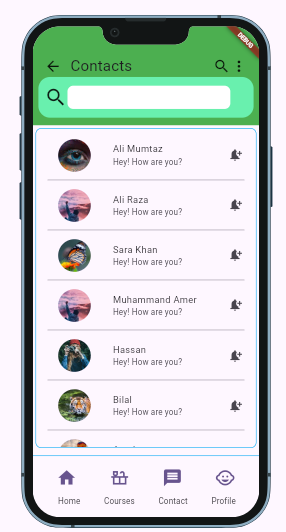

# WhatsApp Chat Layout UI – Flutter

A beginner-friendly Flutter project that recreates a WhatsApp-style chat interface using Flutter widgets. This project focuses on designing a clean and attractive messaging screen.



## ✨ Features

- WhatsApp-style chat screen design.
- Custom chat bubbles for sent and received messages.
- User profile and contact information.
- Message timestamps.
- Clean and responsive UI layout.
- Flutter widgets for building chat interfaces.

## 🛠️ Technologies Used

- Flutter
- Dart
- Visual Studio Code

## 🚀 Getting Started

1. Clone this repository:

   ```bash
   git clone WhatAppchat-layout_flutter
   ```

2. Open the project in VS Code.

3. Install dependencies:

   ```bash
   flutter pub get
   ```

4. Run the application:

   ```bash
   flutter run
   ```

## 📖 Flutter Widgets Used

This project helps beginners understand how to use Flutter widgets to design a chat interface.

Some useful widgets include:

- `Scaffold` – Creates the main screen structure.
- `AppBar` – Displays the chat title and actions.
- `Column` – Arranges widgets vertically.
- `Row` – Arranges widgets horizontally.
- `Container` – Creates and styles chat message bubbles.
- `CircleAvatar` – Displays user profile pictures.
- `ListView` – Displays a scrollable chat message list.
- `TextField` – Creates a message input field.
- `IconButton` – Adds interactive icon buttons.

## 🎯 Learning Objective

The purpose of this project is to practice Flutter UI development and understand how different widgets work together to create a WhatsApp-inspired chat layout.

## 👨‍💻 Author

**Ali Mumtaz**

GitHub: [AliMumtaz-svg](https://github.com/AliMumtaz-svg)
